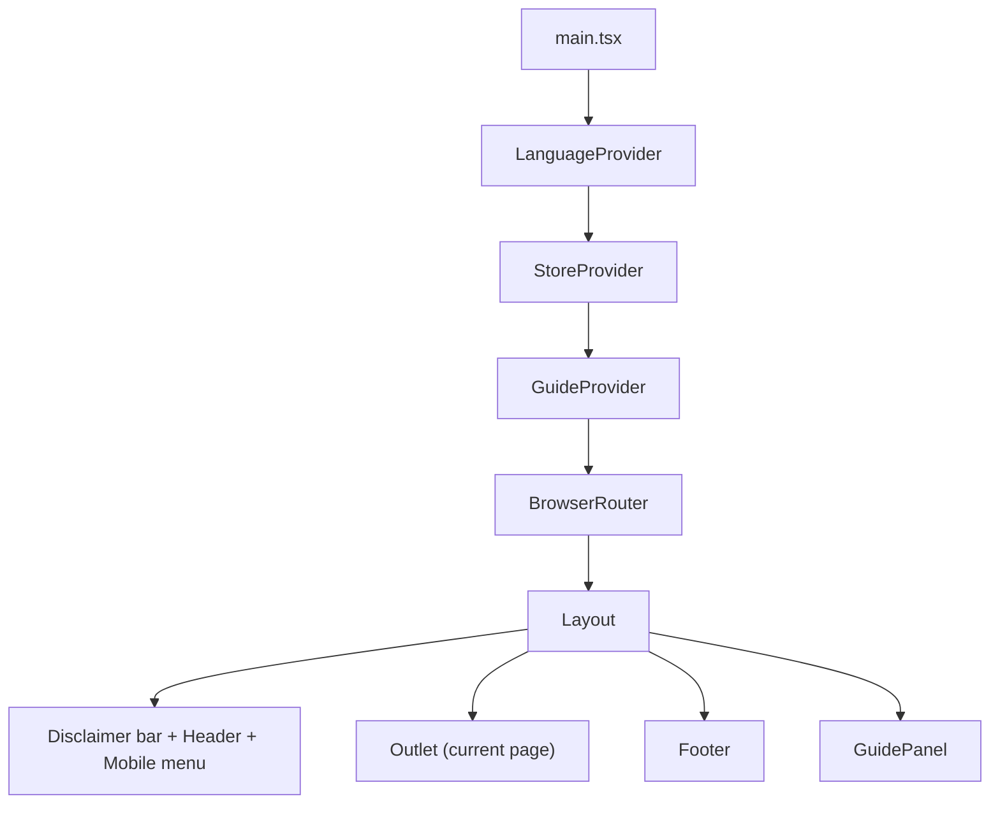
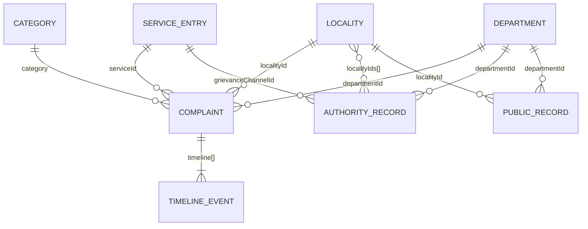
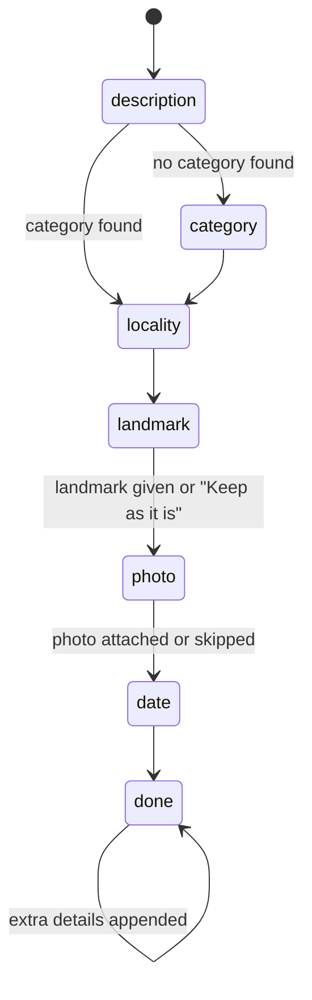
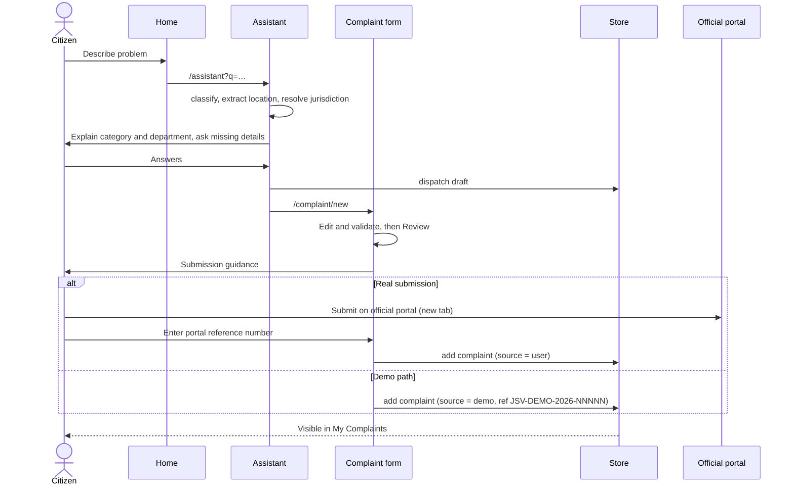
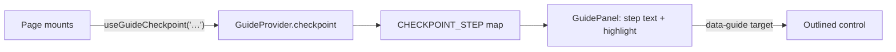

# JanSeva AI — Architecture

This document describes how the JanSeva AI prototype is built: the stack, the folder structure, the data model, how state flows, and the logic behind the assistant, the jurisdiction rules, the dashboard metrics and the first-complaint guide. It reflects the code at the time of writing; where a number is quoted (record counts, versions), it was read from the code or the lockfile, not estimated.

For installation, the page list and the judge demo script, see [README.md](README.md).

---

## 1. What this is (and is not)

| It is | It is not |
|---|---|
| A frontend-only single-page app (SPA) | A system connected to any government portal |
| Fully runnable with `npm install` + `npm run dev` | Dependent on a backend, database, API key or login |
| A rule-based simulation of an AI assistant | A trained language model |
| Built on synthetic, clearly labelled sample data | A source of real Faridabad performance statistics |

Everything runs in the browser. The only network requests are for the app's own files and the two Google Fonts (Inter, Noto Sans Devanagari) loaded in `index.html`. Without network access to Google Fonts the app falls back to system fonts and still works.

---

## 2. Stack

Versions are those resolved in `package-lock.json`.

| Layer | Technology | Version | Why |
|---|---|---|---|
| UI library | React | 18.3.1 | Component model, hooks, context |
| Language | TypeScript (strict mode) | 5.6.3 | Typed domain model shared by every page |
| Build / dev server | Vite + `@vitejs/plugin-react` | 5.4.21 / 4.7.0 | Fast dev server with hot reload, simple production build |
| Routing | React Router (`react-router-dom`) | 6.30.6 | Client-side routes with `BrowserRouter` |
| Styling | Tailwind CSS + PostCSS + Autoprefixer | 3.4.19 / 8.5.32 / 10.6.2 | Utility classes with a strict custom palette |
| Charts | Recharts | 2.15.4 | Monthly trend line chart on the dashboard |
| Icons | Lucide React | 0.460.0 | Functional icons only (search, attach, menu, external link) |
| Persistence | Browser `localStorage` | — | Keeps demo records across refreshes |

There is no state-management library (Redux, Zustand, etc.), no form library, no CSS-in-JS and no test framework. State is handled with React `useReducer` / `useState` and context.

### Build configuration

| File | Purpose |
|---|---|
| `vite.config.ts` | React plugin; dev server on port 5173 |
| `tsconfig.json` | `strict`, `noUnusedLocals`, `noUnusedParameters`, `moduleResolution: bundler`, `noEmit` |
| `tailwind.config.js` | Colour tokens, font stack, border radius (3px default) |
| `postcss.config.js` | Runs Tailwind and Autoprefixer |
| `package.json` scripts | `dev` → `vite`; `build` → `tsc -b && vite build`; `preview` → `vite preview` |

`npm run build` type-checks first, so a type error fails the build.

---

## 3. Folder structure

```
.
├── index.html                  Entry HTML, font links, root <div>
├── package.json / package-lock.json
├── vite.config.ts  tsconfig.json  tailwind.config.js  postcss.config.js
├── README.md                   Run instructions, page list, judge demo script
├── ARCHITECTURE.md             This document
└── src/
    ├── main.tsx                Providers + route table
    ├── index.css               Tailwind layers, component classes, mobile rules, guide styles
    │
    ├── data/                   Typed data — no UI code
    │   ├── types.ts            Every domain type (Complaint, ServiceEntry, PublicRecord, …)
    │   ├── reference.ts        Categories, localities, departments, jurisdiction rules, dataset dates
    │   ├── directory.ts        Government services (12) and authority records (9)
    │   ├── complaints.ts       Seed complaints for "My Complaints" (12)
    │   └── publicDataset.ts    Deterministic generator for the dashboard dataset (777 records)
    │
    ├── lib/                    Pure logic — no React
    │   ├── intent.ts           Keyword classifier, location extraction, complaint text builder, example prompts
    │   ├── assistantEngine.ts  Assistant conversation state machine
    │   ├── metrics.ts          Dashboard filters and aggregations
    │   ├── validation.ts       Complaint form and reference-number validation
    │   ├── format.ts           en-IN date and number formatting
    │   └── storage.ts          Safe localStorage wrapper (janseva.v1.* keys)
    │
    ├── state/                  React context providers
    │   ├── store.tsx           Complaints + current draft (useReducer, persisted)
    │   ├── i18n.tsx            Language (English / हिंदी) and UI strings
    │   └── guide.tsx           First-complaint guide state and checkpoints
    │
    ├── components/
    │   ├── Layout.tsx          Disclaimer bar, header, mobile menu, footer, guide panel mount
    │   ├── GuidePanel.tsx      Floating step-by-step guide
    │   ├── Status.tsx          Status, status-source and verification labels
    │   ├── ui.tsx              PageHeader, Field, Notice, PortalLink, EmptyState, …
    │   ├── assistant/          ChatBubble, SummaryPanel
    │   ├── complaint/          ComplaintForm, ComplaintReview, SubmissionGuidance, StepIndicator
    │   └── dashboard/          Charts (category bar list, trend line chart)
    │
    └── pages/                  One file per route
        ├── HomePage.tsx            /
        ├── AssistantPage.tsx       /assistant
        ├── NewComplaintPage.tsx    /complaint/new
        ├── ComplaintsPage.tsx      /complaints
        ├── ComplaintDetailPage.tsx /complaints/:id
        ├── PublicDashboardPage.tsx /public-dashboard
        ├── AuthoritiesPage.tsx     /authorities
        ├── ServicesPage.tsx        /services
        ├── PrivacyPage.tsx         /privacy
        ├── DemoSettingsPage.tsx    /demo
        ├── MockPortalPage.tsx      /mock-portal/:id
        └── NotFoundPage.tsx        *
```

**Dependency direction:** `pages` → `components` → `state` / `lib` → `data`. `data` and `lib` never import React components, so the logic can be tested or reused without the UI. (`lib/intent.ts` and `lib/assistantEngine.ts` import from `data`; `state/i18n.tsx` exports the `Lang` type that the assistant engine uses.)

---

## 4. Application shell



- **Provider order matters.** `GuideProvider` sits outside `BrowserRouter`, so it holds state only. The `useStartGuide()` hook, which navigates, is called from components inside the router.
- **`Layout`** renders on every route. It scrolls to the top and closes the mobile menu on each route change.
- **Routes** are declared in `main.tsx` as children of a single layout route.

### Routes

| Path | Page | Purpose |
|---|---|---|
| `/` | HomePage | Problem input, common issues, recent complaints, area metrics, guide entry |
| `/assistant` | AssistantPage | Chat + live complaint summary. Accepts `?q=` to start with a message |
| `/complaint/new` | NewComplaintPage | Edit → Review → Submission guidance → Done |
| `/complaints` | ComplaintsPage | Search, filter, sort the citizen's complaints |
| `/complaints/:id` | ComplaintDetailPage | Milestones, timeline, follow-ups, verification, demo controls |
| `/public-dashboard` | PublicDashboardPage | Aggregated sample statistics. Accepts `?locality=` |
| `/authorities` | AuthoritiesPage | Responsibility by locality + office directory |
| `/services` | ServicesPage | Government services catalogue |
| `/privacy` | PrivacyPage | Privacy notice |
| `/demo` | DemoSettingsPage | Stored-data summary, reset, guide launcher, judge script |
| `/mock-portal/:id` | MockPortalPage | Placeholder for official channels whose URL is not verified |
| `*` | NotFoundPage | Unknown routes |

---

## 5. Data model

All types live in `src/data/types.ts`.



### Reference data (`reference.ts`)

| Entity | Count | Notes |
|---|---|---|
| `Category` | 8 | `roads`, `parking`, `garbage`, `water`, `streetlights`, `health`, `education`, `other`. Each has an English and Hindi label and an illustrative `slaDays` (3–30) used for "overdue" |
| `Locality` | 6 | Sector 15, NIT Faridabad, Old Faridabad, Ballabgarh, Sector 21, Greater Faridabad (Sector 86). Real area names; ward numbers, PIN assignments and landmarks are illustrative. Each has search `aliases` (English + Hindi) and 3 `landmarks` |
| `Department` | 9 | `mc-roads`, `mda-roads`, `mc-sanitation`, `mc-water`, `mc-electrical`, `traffic`, `health`, `education`, `cpgrams` |

Constants: `SNAPSHOT_DATE = 2026-10-28` (the dataset's "today") and `DATASET_START = 2026-05-01`.

### Directory data (`directory.ts`)

- **`SERVICES` (12).** Each has a `urlStatus`:
  - `public` (8): official government domains that responded when checked on 29 Oct 2026 — pgportal.gov.in, cmharyanacell.nic.in, haryanapolice.gov.in, echallan.parivahan.gov.in, dhbvn.org.in, esanjeevani.mohfw.gov.in, saralharyana.gov.in, india.gov.in.
  - `mock` (4): `mcf-grievance`, `mda-grievance`, `mcf-water`, `school-grievance`. These route to `/mock-portal/:id`.
  - `integration`: `prepare` (5), `link` (6), `direct-planned` (1). No integration is live.
- **`AUTHORITIES` (9).** Office designations with fictional officers ("Sample Officer A" …), `example.org` email addresses, `isSample: true` and an empty `verifiedOn` (shown as "Not verified — sample record").

### Complaint (`complaints.ts`, user-created records)

Key fields: `ref`, `title`, `category`, `localityId`, `landmark`, `departmentId`, `serviceId`, `status`, `statusSource`, `citizenVerification`, `timeline[]`, `isDemo`.

- **`status`** is one of `Submitted`, `Acknowledged`, `In Progress`, `Action Reported`, `Resolved`, `Reopened`, `Overdue`.
- **`statusSource`** is where the latest status came from: `official` (sample official record), `user` (entered by the citizen) or `demo` (simulated).
- **`citizenVerification`** is tracked separately from `status`: `not-requested`, `pending`, `confirmed`, `disputed`. A department-reported `Resolved` never sets it to `confirmed`.
- **`TimelineEvent`** has a `stage`, `date`, `note`, `source`. Events the citizen adds carry `removable`, `prevStatus` and `prevVerification` so they can be undone.

Seed data: 12 complaints across all statuses and several sources.

### Public dataset (`publicDataset.ts`)

`PublicRecord` is anonymised: `incidentId`, `localityId`, `category`, `departmentId`, `landmark`, `received`, `status`, `resolvedOn` (nullable), `feedback` (`confirmed` / `disputed` / `none`). It has no names, contacts or addresses.

The dataset is **generated at load time** by a seeded PRNG (`mulberry32`, seed `20261028`), so it is identical on every load and for every visitor:

1. For each locality × category, generate incidents in proportion to illustrative weights. A share of road and water incidents is shifted into July–August to mimic the monsoon.
2. Each incident gets 1–4 complaint records (duplicate reports by different residents), sharing an `incidentId`.
3. Each record's status depends on its age against an illustrative per-department resolution speed. About 10% of incidents never resolve; some resolved records lose their `resolvedOn` date (missing data); some disputed resolutions become `Reopened`. Open records older than the category's `slaDays` are marked `Overdue` with 75% probability, otherwise given a progress status.

Resulting dataset: **777 complaint records, 477 distinct incidents**, received 1 May – 27 Oct 2026.

| Status | Records |
|---|---|
| Resolved | 627 |
| Overdue | 66 |
| Reopened | 29 |
| Action Reported | 22 |
| In Progress | 17 |
| Acknowledged | 11 |
| Submitted | 5 |

---

## 6. State management

### Store (`state/store.tsx`)

`useReducer` holding `{ complaints, draft }`.

| Action | Effect |
|---|---|
| `add` | Prepends a new complaint |
| `delete` | Removes a complaint (offered only for demo records) |
| `event` | Appends a timeline event; optionally changes `status` (and `statusSource`) and `citizenVerification`; stores the previous values on the event |
| `removeEvent` | Removes a removable event and restores the stored previous status / verification |
| `draft` | Replaces the complaint draft passed from the assistant to the form |
| `reset` | Restores seed complaints and an empty draft |

The UI only offers "Undo" on the **newest** event, so status always reverts in the right order.

### Persistence (`lib/storage.ts`)

All keys are prefixed `janseva.v1.`. Every read and write is wrapped in `try/catch`, so the app works when storage is blocked (private windows, disabled site data).

| Key | Contents |
|---|---|
| `janseva.v1.complaints` | Complaint list |
| `janseva.v1.draft` | Current draft, **without** `photoUrl` |
| `janseva.v1.lang` | `en` or `hi` |
| `janseva.v1.guide` | `{ active, furthest, dismissed }` |

Photos are never stored. They are previewed through `URL.createObjectURL`, which only lives for the page session; after a reload the draft keeps only the file name.

**Reset demo data** (`/demo`) removes every `janseva.v1.*` key and dispatches `reset`.

### Language (`state/i18n.tsx`)

A `STRINGS` table keyed by id with `en` and `hi` values, exposed through `useLang()` as `{ lang, setLang, t }`. It translates the navigation, the main page titles and labels, the assistant's prompts and replies, the guide and the generated complaint text. The complaint form's field labels, the jurisdiction explanations and most directory content are English-only.

### Guide (`state/guide.tsx`)

See section 10.

---

## 7. Assistant

The assistant is deterministic. The same inputs always produce the same replies. Nothing is sent anywhere.

### Classification (`lib/intent.ts`)

- **`classify(text)`.** Each category has an English + Hindi keyword list (e.g. roads: `pothole`, `road`, `गड्ढा`, `सड़क`). The text is lowercased and checked for each keyword. A shorter match contained in a longer match is dropped (`streetlight` inside `streetlights`). Categories are ranked by number of distinct matches. If `roads` ties with another category, the other category wins, because "road" is often just context ("parked on the road"). It returns the category, the matched terms and a runner-up.
- **`extractLocation(text)`.** Finds a locality by its aliases, a 6-digit PIN starting with `1`, and a landmark phrase:
  - English: `near` / `opposite` / `behind` / `next to` / `in front of` / `outside` followed by the words up to the next punctuation mark, or up to an `in` / `at` / `of` that is followed by another word ("near Sector 15 market in Faridabad" → "near Sector 15 market").
  - Hindi: up to four words before `के पास` / `के सामने` / `के पीछे`.
- **`buildComplaintText(draft, lang)`.** Assembles a formal complaint (subject, addressee, location, description, date noticed, photo note, request) in English or Hindi.

### Jurisdiction (`reference.ts → resolveJurisdiction`)

Maps category + locality to a department, a service channel and a plain-language reason:

| Category | Rule |
|---|---|
| Roads | Greater Faridabad → development authority (`mda-roads`, `mda-grievance`); elsewhere → municipal roads (`mc-roads`, `mcf-grievance`) |
| Water | Greater Faridabad → development authority; elsewhere → municipal water (`mc-water`) |
| Garbage | Municipal sanitation |
| Streetlights | Municipal electrical |
| Parking | Traffic police (`haryana-police`) |
| Health | Civil Surgeon office, via CM Window |
| Education | District Education Office, via CM Window |
| Other | General grievances (CPGRAMS) |

These rules are illustrative sample data, not verified administrative boundaries.

### Conversation state machine (`lib/assistantEngine.ts`)



- **`nextAsk(draft)`** returns the first missing item in this order: category → locality → landmark (an auto-detected landmark must be confirmed or refined) → photo (or skipped) → date → done.
- **`absorb(draft, text, asked)`** merges a typed message into the draft. Its meaning depends on what was last asked: a landmark answer sets the landmark; otherwise the text is added to the description. It then re-runs classification and location extraction. A category the user picked by hand is never overridden.
- **`respond(before, after, lang)`** produces replies: an explanation when the category changes ("matched the term …"), an explanation when the department or channel becomes known (location, reason, channel, and whether it is a mock link), then the next question.
- **Option buttons** on assistant messages (category, locality, keep landmark, attach / skip photo, date, review) update the draft directly.

`AssistantPage` adds a 450 ms "Checking the service directory…" delay before replies, handles `?q=`, photo selection (images only, max 5 MB), and builds the `ComplaintDraft` for `/complaint/new` when the user selects **Review complaint**. That button is enabled once a category and a locality are known.

---

## 8. Complaint flow



### Validation (`lib/validation.ts`)

| Field | Rule |
|---|---|
| Title | 10–120 characters |
| Category, state, city, locality, department, channel | Required |
| Description | At least 30 characters |
| PIN code | `^[1-9][0-9]{5}$` |
| Coordinates (optional) | `lat, long` with \|lat\| ≤ 90 and \|long\| ≤ 180 |
| Date noticed | Required, not in the future |
| Complaint text | At least 50 characters |
| Aadhaar guard | A 12-digit number pattern in the description or text is rejected |
| Portal reference | 4–40 characters, letters / digits / `/ - _ .` |

On submit, the first invalid field is focused and an error summary is shown.

### Tracking (`ComplaintDetailPage`)

- **Six milestones:** prepared, submitted, acknowledged, assigned, action reported (or resolved), citizen verification (or disputed). Each shows its date and source, or "Not yet recorded".
- **Timeline:** newest first. The first 4 events are shown, with an option to show all.
- **Citizen actions** add timeline events with source `user` (or `demo` on demo records):
  - Add a follow-up.
  - Confirm the fix.
  - Dispute the fix, which sets status to `Reopened` and verification to `disputed`.
  - Undo the newest event.
- **Demo records only:** "Simulate next update" steps through Acknowledged → In Progress → Action Reported → Resolved (verification becomes `pending`), and Reopened → Action Reported. Demo records can be deleted.

### Official links (`components/ui.tsx → PortalLink`)

Every portal link opens in a new tab with `rel="noopener noreferrer"`. Mock links open the in-app placeholder page. Each link is labelled "Official domain" or "Mock link (demo)".

---

## 9. Public dashboard

Implemented in `PublicDashboardPage.tsx` with pure functions from `lib/metrics.ts`.

### Filters

State and city (Haryana / Faridabad only), ward / locality, PIN code, a date range bounded by the dataset, and category. Tapping a category row or a locality filters the dashboard; tapping it again clears the filter. `?locality=` sets the initial locality (used by the Home page link). On phones the filters are collapsed behind a **Filters** toggle.

### Metric definitions

| Metric | Definition in code |
|---|---|
| Complaints registered | Count of records in the filter |
| Distinct incidents | Count of unique `incidentId` |
| Recorded as resolved | `status === 'Resolved'` |
| Awaiting action | Status in `Submitted`, `Acknowledged`, `In Progress`, `Overdue`, `Reopened` (excludes `Action Reported`, shown separately) |
| Overdue | `status === 'Overdue'` (included in Awaiting action) |
| Citizen-confirmed | `feedback === 'confirmed'`; disputed shown alongside |
| Median recorded resolution time | Median days from `received` to `resolvedOn` over resolved records **with** a date. The sample size `n` and the number of records missing a date are shown |

### Views

- **Category chart:** an HTML bar list where each row is a real `<button>`, so the whole row is a tap target and it works with a keyboard.
- **Trend chart:** a Recharts line chart of received vs. recorded-as-resolved per month. Resolved counts are by month of `resolvedOn`. October is marked partial. Colours `#2A78AB` / `#C47F1F` were checked with a colour-vision-deficiency palette validator. The resolved series is also dashed, so it doesn't rely on colour alone.
- **"View as table"** under each chart.
- **Locality comparison:** ignores the locality / PIN filter so all localities stay comparable.
- **Department response table:** uses neutral wording, and no individual officer is assessed.
- **Recurring problems:** the same locality + category + landmark with at least 3 distinct incidents across at least 3 different months.
- **Definitions, data source, coverage and limitations** sections at the bottom of the page.

The citizen's own demo records are **not** included in dashboard figures.

---

## 10. First-complaint guide



- **Checkpoints.** Each page reports where it is in the flow while mounted:

  | Checkpoint | Reported by | Step |
  |---|---|---|
  | `home` | HomePage | 1 |
  | `assistant` | AssistantPage | 2 |
  | `assistant-ready` | AssistantPage, once everything is asked | 3 |
  | `form-edit` | NewComplaintPage, edit step | 4 |
  | `form-review` | NewComplaintPage, review step | 5 |
  | `form-guidance` | NewComplaintPage, guidance step | 6 |
  | `done` | NewComplaintPage, done step | 7 |
  | `detail` | ComplaintsPage, ComplaintDetailPage | 7 (only after step 6 was reached) |

- **Progress.** `furthest` records the furthest step reached. On a page without a checkpoint, the panel offers "Continue where I left off".
- **Highlighting.** Target elements carry `data-guide="…"`. The panel adds the `guide-target` class (amber outline) to the current step's target, re-checking every 400 ms because targets render lazily. Once per step, it scrolls the target clear of the sticky header and the panel. Targets too tall to fit are aligned to their top.
- **Layout.** While the guide is active, `body.guide-open` adds bottom padding to `<main>` so the panel never hides the end of a page. The panel is collapsible.
- **Entry points:** the Home banner (first visit, until dismissed), the Home link afterwards, the account menu, the mobile menu, the footer and Demo settings.

---

## 11. Design system

### Colour tokens (`tailwind.config.js`)

| Token | Hex | Use |
|---|---|---|
| `canvas` | `#F7F8FA` | Page background |
| `surface` | `#FFFFFF` | Panels |
| `ink` | `#202B36` | Main text |
| `muted` | `#667085` | Secondary text |
| `accent` | `#244C66` | Primary actions, links (`accent-dark` `#1B3A4F`, `accent-tint` `#EAF0F4`) |
| `line` | `#DCE1E6` | Borders |
| `ok` | `#247548` | Success / resolved |
| `warn` | `#A86612` | Warnings, demo labels, guide highlight |
| `crit` | `#B42318` | Errors, overdue, disputed |

No gradients, glow effects or emoji are used. Corners are 3–4px.

### Component classes (`index.css`)

`btn`, `btn-primary`, `btn-secondary`, `btn-ghost`, `btn-danger`, `input`, `input-error`, `label`, `hint`, `error-text`, `link`, `panel`, `section-title`, `eyebrow`, `table-base`, `tnum` (tabular numbers), `container-page`, `tap`.

### Responsive and accessibility rules

- **Breakpoints:** Tailwind defaults (`sm` 640, `md` 768, `lg` 1024, `xl` 1280).
- **Phones (≤ 767px):**
  - `.input` and `.btn` are at least 44px tall, and `.tap` gives links the same height.
  - Inputs use 16px text so iOS does not zoom on focus.
  - Responsive grids declare `grid-cols-1` as their base, so wide content cannot stretch the page.
  - Wide dashboard tables become card lists below `md`.
- **Tested:** every route has no horizontal scrolling at 320px and 375px wide.
- **Accessibility:**
  - Visible focus outline.
  - Labels on every field; errors linked with `aria-describedby` and announced with `role="alert"`.
  - `aria-pressed` on toggles and `aria-expanded` on disclosures.
  - Screen-reader text for icon-only buttons and new-tab links.
  - `lang` attribute updated when the language changes.

---

## 12. Privacy and trust rules built into the code

- No Aadhaar, bank details or passwords are requested, and an Aadhaar-like number is rejected by validation.
- No complainant names or contacts exist in the public dataset.
- Photos stay in the browser as object URLs and are never persisted or uploaded.
- Every status shows its source. Simulated records carry "Demo record — not submitted to government".
- A persistent disclaimer bar appears on every page, and `/privacy` explains data handling.
- The assistant page states that it is rule-based, not a trained AI model.

---

## 13. Build output and deployment

- `npm run build` produces `dist/` with one JS bundle (about 719 kB minified, 209 kB gzip) and one CSS file (about 30 kB). Vite warns that the JS chunk is over 500 kB. This is expected for a prototype that bundles Recharts; route-level code splitting would remove the warning.
- The app uses `BrowserRouter`. A static host must serve `index.html` for unknown paths (SPA fallback), otherwise refreshing a deep link such as `/complaints` returns a 404. Vite's dev and preview servers already do this. On Netlify use a `_redirects` rule; on Vercel a rewrite; GitHub Pages needs `HashRouter` or a `404.html` copy of `index.html`.

---

## 14. Known limitations

- Keyword rules cover common phrasings only. Unrecognised text asks the user to pick a category.
- Jurisdiction rules, ward numbers, PIN assignments, landmarks and service timelines are illustrative.
- 4 of the 12 service links are mock placeholders. The 8 "official domain" links were checked for reachability only, not for the exact form location.
- Hindi covers navigation, main labels, the assistant, the guide and the complaint text, but not every label.
- There are no automated tests. Verification so far has been manual in the browser plus the TypeScript build.
- State lives in one browser. There is no sync, no accounts and no server.

---

## 15. Extending it

| To add | Change |
|---|---|
| A complaint category | `CategoryId` in `types.ts`, `CATEGORIES` in `reference.ts`, keywords in `intent.ts`, a branch in `resolveJurisdiction`, title template in `intent.ts` |
| A locality | `LOCALITIES` in `reference.ts` (with aliases and landmarks), weight in `publicDataset.ts`, `localityIds` on relevant `AUTHORITIES` |
| A service | An entry in `SERVICES`; use `urlStatus: 'mock'` until the official URL is verified |
| A translated string | A key in `STRINGS` (`i18n.tsx`), then `t('key')` |
| A guide step | A checkpoint in `guide.tsx`, a step in `GuidePanel.tsx`, `useGuideCheckpoint()` in the page, `data-guide` on the target |
| A real backend | Replace the reducer's persistence in `store.tsx` and the generator in `publicDataset.ts` with API calls; the types in `types.ts` are the contract |
| A real language model | Replace `classify` / `absorb` / `respond` behind the same `AssistantDraft` interface. Keep jurisdiction resolution rule-based so routing stays explainable |
