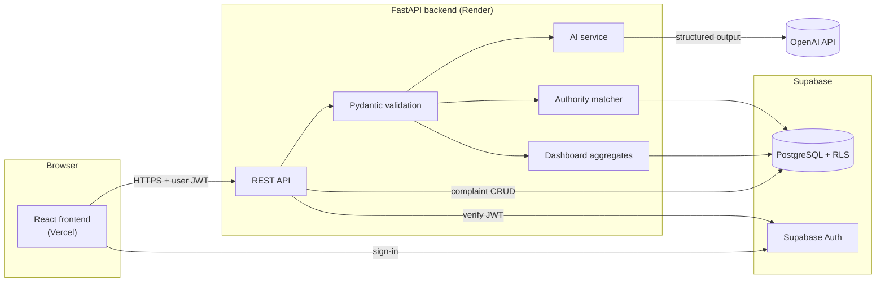
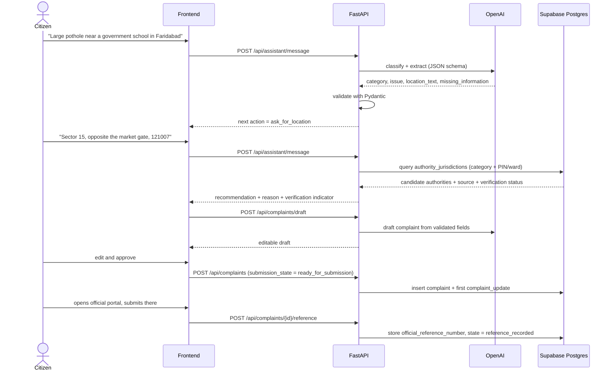
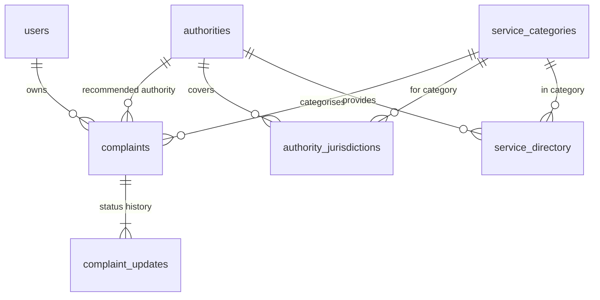
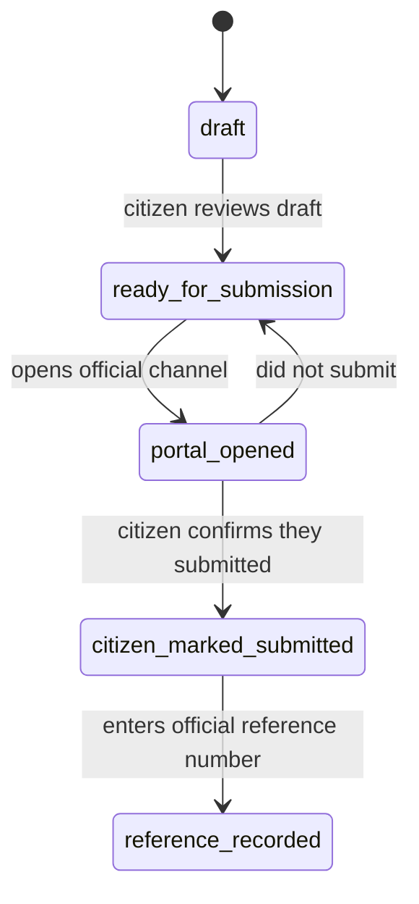
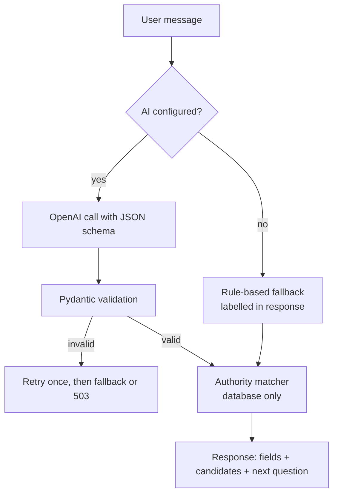

# JanSeva AI — Tech Stack and Project Structure

**One Platform. Every Citizen. Better Governance.**

This document defines the technology stack, repository structure, data model, API contract and security model for the JanSeva AI hackathon MVP, as set out in the project brief. It is the build plan for the full-stack version.

> **Current status — read this first.**
> The repository today contains a **frontend-only prototype**: React + TypeScript + Vite + Tailwind, with local sample data and a **rule-based** (not AI) assistant. There is **no backend, database, authentication or OpenAI integration yet**. Those are the planned components described below.
> Everything in this document marked **Planned** does not exist in the code yet. How the current prototype works is documented in [ARCHITECTURE.md](ARCHITECTURE.md).

---

## Contents

1. [Status at a glance](#1-status-at-a-glance)
2. [Target architecture](#2-target-architecture)
3. [Technology stack](#3-technology-stack)
4. [Repository structure](#4-repository-structure)
5. [Environment variables](#5-environment-variables)
6. [Database schema](#6-database-schema)
7. [Status model](#7-status-model)
8. [API contract](#8-api-contract)
9. [AI workflow](#9-ai-workflow)
10. [Authority matching](#10-authority-matching)
11. [Public dashboard metrics](#11-public-dashboard-metrics)
12. [Security and privacy](#12-security-and-privacy)
13. [Local development](#13-local-development)
14. [Deployment](#14-deployment)
15. [Migration plan from the current prototype](#15-migration-plan-from-the-current-prototype)
16. [Implemented, simulated and planned features](#16-implemented-simulated-and-planned-features)
17. [Acceptance checklist](#17-acceptance-checklist)
18. [What must not be claimed](#18-what-must-not-be-claimed)

---

## 1. Status at a glance

| Area | Target (from brief) | Status today |
|---|---|---|
| Frontend | React, TypeScript, Vite, Tailwind, React Router, Recharts, Lucide | **Implemented** (single-package repo, not yet under `frontend/`) |
| Backend | Python, FastAPI, Pydantic | **Planned** |
| Database | Supabase PostgreSQL | **Planned** (today: browser `localStorage`) |
| Authentication | Supabase Auth + Row Level Security | **Planned** (today: none; a single sample "Demo citizen") |
| AI | OpenAI API with structured outputs | **Planned** (today: deterministic keyword rules, labelled as such) |
| Authority matching | Database jurisdiction rules from verified records | **Partially implemented** as hard-coded sample rules in `src/data/reference.ts` |
| Public dashboard | Aggregates computed from stored records | **Implemented on a synthetic dataset** generated in the browser |
| Deployment | Vercel + Render + Supabase | **Planned** |
| English / Hindi | Interface, assistant prompts, complaint drafts | **Implemented** for navigation, main labels, assistant, guide and complaint text |

---

## 2. Target architecture



**Rules that shape this design**

1. **The backend is the only control point.** It makes all AI calls, validates all input and output, performs all writes, and enforces access to private records. The frontend never holds secret keys.
2. **The model advises; the database decides.** The AI suggests a category and extracts fields. The authority and official URL always come from verified directory records in PostgreSQL, never from model text.
3. **Defence in depth for private data.** The backend checks ownership on every request, *and* Row Level Security on the tables blocks cross-user access even if a query is wrong.
4. **The public dashboard returns aggregates only.** No endpoint used by the dashboard returns raw complaint rows.
5. **Honest fallbacks.** If the OpenAI key is missing or a call fails, the API returns a clearly labelled rule-based result or an explicit "AI unavailable" error, never a mock response presented as live AI.

### Request flow: the pothole scenario



---

## 3. Technology stack

### Frontend

| Technology | Role | Status |
|---|---|---|
| React 18 | UI components and hooks | Implemented (18.3.1) |
| TypeScript (strict) | Typed models shared across pages | Implemented (5.6.3) |
| Vite | Dev server and build | Implemented (5.4.21) |
| Tailwind CSS 3 | Styling with the institutional palette | Implemented (3.4.19) |
| React Router 6 | Client-side routing | Implemented (6.30.6) |
| Recharts | Dashboard trend chart | Implemented (2.15.4) |
| Lucide React | Functional icons only | Implemented (0.460.0) |
| `@supabase/supabase-js` | Sign-in and session token for API calls | **Planned** |
| Typed API client (`fetch` wrapper) | Calls to the FastAPI backend | **Planned** |

Versions in the "Implemented" rows are the ones resolved in `package-lock.json`.

### Backend — Planned

| Technology | Role |
|---|---|
| Python 3.11+ | Runtime |
| FastAPI | REST API, OpenAPI docs at `/docs` |
| Uvicorn | ASGI server |
| Pydantic v2 + `pydantic-settings` | Request/response schemas, AI-output validation, typed settings from environment |
| `openai` (official Python SDK) | Classification and drafting with structured (JSON-schema) outputs |
| `supabase` (Python client) or a Postgres driver | Database access from the backend |
| A rate limiter (e.g. `slowapi`) | Per-IP / per-user request limits on AI endpoints |
| `pytest` + FastAPI `TestClient` | Backend tests |

Exact package versions are pinned in `backend/requirements.txt` when the backend is created.

### Data and authentication — Planned

| Technology | Role |
|---|---|
| Supabase PostgreSQL | Complaints, status history, directory, jurisdiction rules |
| Supabase Auth | Optional user accounts; the backend verifies the user's access token |
| Row Level Security | Owner-only access to private complaint data |

### AI — Planned

| Item | Decision |
|---|---|
| Provider | OpenAI API |
| Model | Set by the `OPENAI_MODEL` environment variable, not hard-coded |
| Output format | Structured outputs validated against a JSON schema, then re-validated with Pydantic |
| Uses | Classification, field extraction, missing-detail detection, bilingual drafting, follow-up guidance |
| Never used for | Official URLs, authority selection, officials' details, procedures, verification status, resolution status |

### Deployment — Planned

| Component | Host |
|---|---|
| Frontend | Vercel |
| Backend | Render (or another Python host) |
| Database and auth | Supabase |

### Optional integrations — Future, only with authorisation

- Google Maps Geocoding API, only if address-to-coordinate conversion is genuinely needed. Location entry must never require a map.
- SMS or email notifications through an authorised provider.
- CPGRAMS and municipal or state APIs for submission and status sync, only after access is formally granted.

---

## 4. Repository structure

### Today

```
.
├── src/                 React app (pages, components, state, lib, data)
├── index.html
├── package.json
├── vite.config.ts  tailwind.config.js  postcss.config.js  tsconfig.json
├── README.md
├── ARCHITECTURE.md      How the current prototype works
└── TECH_STACK.md        This document
```

### Target monorepo

```
janseva-ai/
├── frontend/
│   ├── src/
│   │   ├── components/        Shared UI (status labels, forms, charts, guide panel)
│   │   ├── pages/             One file per route
│   │   ├── layouts/           App shell: header, mobile nav, footer, disclaimer bar
│   │   ├── hooks/             useComplaints, useDashboard, useAuth, useLang …
│   │   ├── services/          api.ts (typed fetch client), supabase.ts (auth only)
│   │   ├── types/             Shared TypeScript types mirroring the API schemas
│   │   ├── i18n/              English / Hindi strings
│   │   └── utils/             Formatting, validation helpers
│   ├── public/
│   ├── index.html
│   ├── package.json
│   ├── vercel.json            SPA rewrite (see §14)
│   └── .env.example
│
├── backend/
│   ├── app/
│   │   ├── main.py            FastAPI app, CORS, routers, exception handlers
│   │   ├── api/               Routers: health, assistant, complaints, authorities, services, dashboard
│   │   ├── schemas/           Pydantic models: requests, responses, AI output
│   │   ├── services/          ai_service, matching_service, dashboard_service, rule_based_fallback
│   │   ├── repositories/      Database access per table; the only layer that talks to Postgres
│   │   └── core/              config (settings), auth (JWT verification), rate_limit, logging
│   ├── tests/                 pytest: schemas, matching, auth boundaries, dashboard aggregates
│   ├── requirements.txt
│   └── .env.example
│
├── database/
│   ├── schema.sql             Tables, enums, indexes, RLS policies
│   └── seed.sql               Labelled sample directory + demo complaints
│
├── docs/
│   ├── ARCHITECTURE.md
│   └── TECH_STACK.md
├── README.md                  Setup, run, demo script
└── .gitignore                 Includes .env, node_modules, dist, .venv, __pycache__
```

### Where today's code goes

| Current file(s) | Target location | Notes |
|---|---|---|
| `src/pages/*` | `frontend/src/pages/` | Unchanged; switch data calls to the API |
| `src/components/Layout.tsx` | `frontend/src/layouts/AppLayout.tsx` | |
| `src/components/*` (others) | `frontend/src/components/` | |
| `src/state/store.tsx` | `frontend/src/hooks/useComplaints.ts` | Reducer replaced by API calls; local storage only for drafts |
| `src/state/i18n.tsx` | `frontend/src/i18n/` | |
| `src/state/guide.tsx` | `frontend/src/hooks/useGuide.ts` | Unchanged behaviour |
| `src/data/types.ts` | `frontend/src/types/` | Aligned with Pydantic schemas |
| `src/lib/format.ts`, `validation.ts` | `frontend/src/utils/` | Server repeats all validation |
| `src/lib/intent.ts`, `assistantEngine.ts` | `backend/app/services/rule_based_fallback.py` | Ported to Python as the labelled no-AI fallback |
| `src/lib/metrics.ts` | `backend/app/services/dashboard_service.py` | Aggregates move to SQL |
| `src/data/reference.ts`, `directory.ts` | `database/seed.sql` | Rules become `authority_jurisdictions` rows |
| `src/data/complaints.ts` | `database/seed.sql` | All rows flagged `is_demo_record = true` |
| `src/data/publicDataset.ts` | `database/seed.sql` (generated once) | Stored as labelled demo rows, not generated in the browser |

---

## 5. Environment variables

Secrets live only in the backend. `.env` files are never committed; each folder ships a `.env.example`.

### `frontend/.env.example`

```bash
# Base URL of the FastAPI backend
VITE_API_BASE_URL=http://localhost:8000

# Supabase project URL and anon (public) key — used only for sign-in.
# The anon key is designed to be public; data is protected by RLS and backend checks.
VITE_SUPABASE_URL=https://your-project.supabase.co
VITE_SUPABASE_ANON_KEY=your-anon-key
```

Anything prefixed `VITE_` is embedded in the browser bundle. Never put a secret in a `VITE_` variable.

### `backend/.env.example`

```bash
# OpenAI — leave empty to run in labelled rule-based fallback mode
OPENAI_API_KEY=
OPENAI_MODEL=

# Supabase
SUPABASE_URL=https://your-project.supabase.co
SUPABASE_SERVICE_ROLE_KEY=        # server only; bypasses RLS — never send to the browser
# Used to verify user access tokens (exact mechanism depends on project's JWT settings)
SUPABASE_JWT_SECRET=

# App
ALLOWED_ORIGINS=http://localhost:5173
DEMO_MODE=true                    # seeds and labels demo records; enables simulated actions
RATE_LIMIT_AI_PER_MINUTE=10
```

---

## 6. Database schema

Planned contents of `database/schema.sql`. Field names follow the brief. Every column that may be unknown is nullable, so missing data is never replaced with invented values.

### Entity relationships



### Enumerations

```sql
create type submission_state as enum (
  'draft',                     -- created, not ready
  'ready_for_submission',      -- reviewed by the citizen
  'portal_opened',             -- official portal opened (NOT a submission)
  'citizen_marked_submitted',  -- citizen says they submitted
  'reference_recorded'         -- official reference number saved
);

create type complaint_status as enum (
  'not_submitted',
  'submitted',
  'acknowledged',
  'in_progress',
  'action_reported',
  'resolved_by_authority',     -- authority says resolved; NOT citizen-confirmed
  'reopened',
  'closed_unresolved'
);

create type status_source as enum (
  'citizen_reported',
  'official_integration',      -- only with an authorised integration
  'admin_verified',
  'demo'
);

create type verification_status as enum ('verified', 'unverified', 'verification_pending');
```

### Tables

```sql
create table users (
  id uuid primary key references auth.users (id) on delete cascade,
  display_name text,
  preferred_language text not null default 'en' check (preferred_language in ('en', 'hi')),
  created_at timestamptz not null default now()
);

create table authorities (
  id uuid primary key default gen_random_uuid(),
  name text not null,
  authority_type text not null,                 -- e.g. municipal_corporation, development_authority, police
  jurisdiction_description text,
  official_website text,
  official_complaint_url text,
  official_contact_details jsonb,               -- only verified, official (not personal) contacts
  verification_status verification_status not null default 'unverified',
  source_url text,
  last_verified_at timestamptz
);

create table service_categories (
  id text primary key,                          -- language-neutral key, e.g. 'road_maintenance'
  name text not null,
  description text,
  keywords text[] not null default '{}',
  required_information text[] not null default '{}',
  default_authority_id uuid references authorities (id),
  verification_notes text
);

create table authority_jurisdictions (
  id uuid primary key default gen_random_uuid(),
  authority_id uuid not null references authorities (id) on delete cascade,
  service_category_id text not null references service_categories (id),
  area_name text,
  ward text,
  pin_code text check (pin_code ~ '^[1-9][0-9]{5}$'),
  road_or_asset_type text,                      -- e.g. 'sector_road', 'master_road', 'internal_lane'
  source_url text,
  verification_status verification_status not null default 'unverified'
);

create table service_directory (
  id uuid primary key default gen_random_uuid(),
  service_name text not null,
  description text,
  category_id text references service_categories (id),
  authority_id uuid references authorities (id),
  official_url text,
  required_documents text[] not null default '{}',
  eligibility_notes text,
  location_scope text,
  source_url text,
  last_verified_at timestamptz
);

create table complaints (
  id uuid primary key default gen_random_uuid(),        -- internal JanSeva ID
  public_code text unique not null,                     -- human-readable JanSeva ID, e.g. 'JS-2026-000123'
  user_id uuid references auth.users (id) on delete set null,
  title text not null,
  description text not null,
  category_id text references service_categories (id),
  locality text,
  ward text,
  pin_code text check (pin_code ~ '^[1-9][0-9]{5}$'),
  latitude double precision check (latitude between -90 and 90),
  longitude double precision check (longitude between -180 and 180),
  authority_id uuid references authorities (id),
  official_reference_number text,                       -- government-issued; never generated by JanSeva
  submission_state submission_state not null default 'draft',
  status complaint_status not null default 'not_submitted',
  status_source status_source not null default 'citizen_reported',
  created_at timestamptz not null default now(),
  updated_at timestamptz not null default now(),
  resolved_at timestamptz,                              -- authority-reported resolution time
  citizen_confirmed_resolved_at timestamptz,            -- separate from resolved_at
  is_demo_record boolean not null default false
);

create table complaint_updates (
  id uuid primary key default gen_random_uuid(),
  complaint_id uuid not null references complaints (id) on delete cascade,
  previous_status complaint_status,
  new_status complaint_status not null,
  update_note text,
  source_type status_source not null,
  source_reference text,
  created_at timestamptz not null default now()
);

create index on complaints (user_id);
create index on complaints (category_id, locality);
create index on complaints (created_at);
create index on complaint_updates (complaint_id, created_at);
create index on authority_jurisdictions (service_category_id, pin_code);
create index on authority_jurisdictions (service_category_id, ward);
```

`gen_random_uuid()` is built into PostgreSQL 13 and later, which Supabase uses.

### Row Level Security

```sql
alter table complaints enable row level security;
alter table complaint_updates enable row level security;
alter table users enable row level security;

-- Citizens see and change only their own complaints
create policy complaints_select_own on complaints
  for select using (auth.uid() = user_id);
create policy complaints_insert_own on complaints
  for insert with check (auth.uid() = user_id);
create policy complaints_update_own on complaints
  for update using (auth.uid() = user_id) with check (auth.uid() = user_id);

-- Updates are visible only through a complaint the user owns
create policy updates_select_own on complaint_updates
  for select using (
    exists (select 1 from complaints c where c.id = complaint_id and c.user_id = auth.uid())
  );
create policy updates_insert_own on complaint_updates
  for insert with check (
    exists (select 1 from complaints c where c.id = complaint_id and c.user_id = auth.uid())
  );

create policy users_self on users
  for all using (auth.uid() = id) with check (auth.uid() = id);

-- Directory tables are public read-only
alter table authorities enable row level security;
alter table service_categories enable row level security;
alter table authority_jurisdictions enable row level security;
alter table service_directory enable row level security;
create policy authorities_read on authorities for select using (true);
create policy categories_read on service_categories for select using (true);
create policy jurisdictions_read on authority_jurisdictions for select using (true);
create policy services_read on service_directory for select using (true);
```

The service-role key bypasses RLS. The backend uses it only for dashboard aggregates and admin tasks, and every user-facing query still filters by the authenticated user's ID.

### Seed data (`database/seed.sql`)

- **Directory:** the 12 services and 9 authority records from the prototype, with `verification_status` set honestly:
  - 8 official domains → `verified` for the domain only, with the check date.
  - 4 unverified channels → `unverified` with no URL presented as official.
  - Fictional officers are **not** carried over; authority rows describe offices, not people.
- **Jurisdictions:** the prototype's sample rules (e.g. Greater Faridabad sector roads → development authority) as `authority_jurisdictions` rows marked `unverified`.
- **Demo complaints:** the sample complaint set, every row `is_demo_record = true`, `status_source = 'demo'`, and no fake government reference numbers.

---

## 7. Status model

The brief requires the interface to tell these states apart. Submission progress and complaint status are **two separate fields**, and authority resolution and citizen confirmation are **two separate timestamps**.



| Interface label | Stored as |
|---|---|
| Draft created | `submission_state = draft` |
| Ready for submission | `submission_state = ready_for_submission` |
| Official portal opened | `submission_state = portal_opened` |
| Citizen marked as submitted | `submission_state = citizen_marked_submitted` |
| Official reference number recorded | `submission_state = reference_recorded`, `official_reference_number` set |
| Status manually reported by the citizen | `complaint_updates.source_type = citizen_reported` |
| Status retrieved from an authorised integration | `source_type = official_integration` (unused until an integration exists) |
| Marked resolved by the authority | `status = resolved_by_authority`, `resolved_at` set |
| Resolution confirmed by the citizen | `citizen_confirmed_resolved_at` set |
| Demo record | `is_demo_record = true`, `source_type = demo` |

Every status change writes a `complaint_updates` row with its source. The current status on `complaints` is a cached copy of the latest update.

---

## 8. API contract

Planned FastAPI endpoints. This is JanSeva's own API, not a government API. All `/api/complaints*` endpoints require an authenticated user and return only that user's records.

| Method | Path | Auth | Purpose |
|---|---|---|---|
| GET | `/health` | — | Liveness, plus whether AI and database are configured |
| POST | `/api/assistant/message` | optional | Interpret a message; return structured fields and the next clarifying question |
| POST | `/api/complaints/classify` | optional | Classify text and extract structured fields |
| POST | `/api/complaints/draft` | optional | Draft complaint text from validated fields |
| POST | `/api/complaints` | user | Save a complaint (generates the internal ID and `public_code`) |
| GET | `/api/complaints` | user | List own complaints; filters: `category`, `locality`, `status`, `from`, `to`, `q` |
| GET | `/api/complaints/{id}` | user | One own complaint with its updates |
| PATCH | `/api/complaints/{id}` | user | Edit permitted fields (title, description, location, submission state) |
| POST | `/api/complaints/{id}/updates` | user | Add a status update; `source_type` forced to `citizen_reported` for citizens |
| POST | `/api/complaints/{id}/reference` | user | Record the official reference number |
| GET | `/api/authorities` | — | Search authorities: `q`, `category`, `pin_code`, `ward` |
| GET | `/api/authorities/{id}` | — | One authority |
| POST | `/api/authorities/match` | — | Match category + location to candidate authorities |
| GET | `/api/services` | — | Search the service directory: `q`, `category` |
| GET | `/api/services/{id}` | — | One service |
| GET | `/api/dashboard/summary` | — | Aggregate KPIs for a period and filter |
| GET | `/api/dashboard/trends` | — | Monthly received / resolved counts |
| GET | `/api/dashboard/categories` | — | Counts by category |
| GET | `/api/dashboard/localities` | — | Counts by locality / ward |
| GET | `/api/dashboard/resolution` | — | Median resolution time with sample size |

Dashboard query parameters: `from`, `to`, `locality`, `ward`, `pin_code`, `category`, `include_demo`.

### Response conventions

- **Errors** use one shape: `{ "error": { "code": "ai_unavailable", "message": "…" } }` with the right HTTP status (400, 401, 403, 404, 422, 429, 503).
- **AI-unavailable** returns `503` with `code: "ai_unavailable"`, or `200` with `"mode": "rule_based_fallback"` when fallback is enabled. Both are explicit.
- **Dashboard responses** always include `period`, `generated_at`, `data_sources` (e.g. `["demo"]`), `sample_size` and `excluded_missing` where relevant.
- **Small counts** in dashboard cells (fewer than 5 complaints) are suppressed or merged, to avoid re-identifying individuals in small areas.

### Example: `POST /api/complaints/{id}/updates`

```jsonc
// Request
{ "new_status": "resolved_by_authority", "update_note": "Portal shows 'Closed' on 4 Nov" }

// Response 201
{
  "id": "6f1c…",
  "complaint_id": "a2e9…",
  "previous_status": "action_reported",
  "new_status": "resolved_by_authority",
  "source_type": "citizen_reported",
  "created_at": "2026-11-04T10:12:00Z"
}
```

A citizen reporting that the authority closed the complaint is stored as `resolved_by_authority` with source `citizen_reported`. It does **not** set `citizen_confirmed_resolved_at`; that needs a separate, explicit confirmation.

---

## 9. AI workflow

### Pipeline



### Classification output schema

The model must return exactly this structure (enforced with a JSON schema, then re-validated by Pydantic):

```json
{
  "category": "road_maintenance",
  "issue_type": "pothole",
  "location_text": "Near a government school in Faridabad",
  "missing_information": ["exact_road_or_locality"],
  "urgency": "potential_safety_concern",
  "request_type": "complaint",
  "recommended_next_action": "ask_for_location",
  "language": "en",
  "authority_match_status": "not_yet_verified",
  "uncertainty": "Road ownership depends on the exact road."
}
```

| Field | Allowed values |
|---|---|
| `category` | `id` values from `service_categories`, or `unknown` |
| `request_type` | `complaint`, `service`, `general_guidance` |
| `recommended_next_action` | `ask_for_location`, `ask_for_details`, `confirm_category`, `match_authority`, `draft_complaint` |
| `language` | `en`, `hi` |
| `authority_match_status` | Always `not_yet_verified` from the model; only the matcher may change it |

### Hard rules

- **No official facts from the model.** The model never supplies authority names, URLs, phone numbers, addresses or officials. Those fields are not in its output schema.
- **No verification from the model.** The model cannot set an authority as verified or a complaint as resolved.
- **Data minimisation.** Only the complaint text and coarse location are sent to the model; no account details, phone numbers or exact addresses unless the citizen typed them into the description.
- **No permanent chat logs.** Raw conversation logs are not stored permanently; only the final structured complaint is saved.
- **Editable drafts.** Hindi and English drafts are always editable and are not authoritative translations of official terms.
- **Neutral drafting.** The draft does not allege earlier failures unless the citizen provided them.

---

## 10. Authority matching

Matching uses database records only. The order of precedence:

1. `authority_jurisdictions` rows matching **category + PIN code**.
2. Else rows matching **category + ward**.
3. Else rows matching **category + area name**.
4. Else the category's `default_authority_id`.
5. Else no match: return general channels (e.g. CPGRAMS) with `match_status = "no_verified_match"`.

The response always includes:

- `candidates[]`: authority, the rule that matched, `source_url`, `verification_status` and `last_verified_at`.
- `match_status`: `verified_match`, `unverified_match`, `multiple_candidates` or `no_verified_match`.
- `reason`: a plain-language explanation shown to the citizen.

If several authorities match — for example, the road may be a sector road (development authority) or an internal lane (municipal corporation) — the API returns `multiple_candidates`. The interface then asks the citizen a disambiguating question instead of guessing.

---

## 11. Public dashboard metrics

All dashboard queries run on the backend and return aggregates only. Each metric states whether it counts complaints **created in the period**; the default is complaints created in the period.

| Metric | Definition |
|---|---|
| Total complaints | Complaints with `created_at` in the period that match the filters |
| Distinct incidents | Clusters of same category + locality + landmark within a set time window (documented rule); duplicates are kept, not deleted |
| Open complaints | `status` in `submitted`, `acknowledged`, `in_progress`, `reopened` |
| Authority-marked resolved | `status = resolved_by_authority` |
| Citizen-confirmed resolved | `citizen_confirmed_resolved_at is not null` |
| Overdue | Open complaints past a deadline **only where a documented deadline exists for the category and authority**; otherwise shown as "No deadline data", never zero |
| Median resolution time | Median of `resolved_at − created_at` over complaints with both timestamps; returns `sample_size` and `excluded_missing` |
| Repeat issues | Same category + locality with reports in at least 3 different months (documented rule); an indicator of recurring reports, not proof of failure |
| Data freshness | `max(updated_at)` of the included records |

Every chart shows the reporting period, a data-source label (*Officially synchronised*, *Citizen reported*, *Manually recorded*, *Demo dataset*, *Verification pending*) and an empty state when data is insufficient. High complaint volume is never presented as evidence of negligence or corruption.

---

## 12. Security and privacy

| Requirement | Implementation |
|---|---|
| Secrets out of the browser | OpenAI and service-role keys only in backend environment variables; `.env` in `.gitignore` |
| Authenticated private data | Backend verifies the Supabase access token on every `/api/complaints*` call |
| Authorisation | Backend checks `user_id` ownership, and RLS policies enforce the same |
| Input validation | Pydantic on every request; length limits; PIN format; coordinate ranges |
| AI output validation | JSON schema plus Pydantic; unknown categories rejected |
| Public data | Dashboard endpoints return aggregates only, with small-count suppression |
| Personal data | No Aadhaar, no passwords in forms, phone optional and never public; an Aadhaar-like pattern is rejected (as in the prototype) |
| Abuse limits | Rate limit on AI endpoints (`RATE_LIMIT_AI_PER_MINUTE`) |
| CORS | `ALLOWED_ORIGINS` set to the frontend domain only |
| Failure states | AI errors return a labelled fallback or `503`; the frontend shows an understandable message |
| Uploads (future) | Type and size validation, private storage bucket, signed URLs, never public |
| Honest labelling | `is_demo_record`, `status_source` and `submission_state` shown in the interface |

---

## 13. Local development

### Today (frontend prototype)

```powershell
npm install
npm run dev
```

Open http://localhost:5173. No keys are needed.

### Planned full stack

**1. Database:** create a Supabase project, then run `database/schema.sql` and `database/seed.sql` in the SQL editor.

**2. Backend (Windows PowerShell):**

```powershell
cd backend
python -m venv .venv
.venv\Scripts\Activate.ps1
pip install -r requirements.txt
copy .env.example .env
uvicorn app.main:app --reload --port 8000
```

API docs: http://localhost:8000/docs.

**3. Frontend:**

```powershell
cd frontend
npm install
copy .env.example .env
npm run dev
```

On macOS / Linux, activate the virtual environment with `source .venv/bin/activate` and use `cp` instead of `copy`.

---

## 14. Deployment

| Component | Host | Settings |
|---|---|---|
| Frontend | Vercel | Root `frontend/`, build `npm run build`, output `dist`, env `VITE_*` |
| Backend | Render (web service) | Root `backend/`, build `pip install -r requirements.txt`, start `uvicorn app.main:app --host 0.0.0.0 --port $PORT`, secrets as env vars |
| Database | Supabase | Run `schema.sql` then `seed.sql`; RLS on |

The frontend uses client-side routing, so Vercel needs an SPA rewrite in `frontend/vercel.json`:

```json
{ "rewrites": [{ "source": "/(.*)", "destination": "/index.html" }] }
```

Without it, refreshing a deep link such as `/complaints` returns a 404.

---

## 15. Migration plan from the current prototype

Ordered to keep one end-to-end complaint journey working at every step.

| Phase | Work | Done when |
|---|---|---|
| 1. Restructure | Move the app into `frontend/`; add `layouts/`, `services/`, `types/`; add `vercel.json` | Prototype runs unchanged from `frontend/` |
| 2. Database | Write `schema.sql` + `seed.sql` from the prototype's data; enable RLS | Seed loads; directory readable; private tables locked |
| 3. Backend core | FastAPI app, settings, `/health`, directory endpoints, complaint CRUD, reference endpoint, updates endpoint | Pothole complaint saved and listed through the API |
| 4. Frontend wiring | Replace `localStorage` store with API calls; add sign-in; show JanSeva ID and reference number separately; add submission-state steps | My Complaints reads from the database |
| 5. AI | Classification + drafting with structured outputs; port rule-based engine as fallback; matcher with `multiple_candidates` | Works with and without `OPENAI_API_KEY`, labelled correctly |
| 6. Dashboard | SQL aggregates and endpoints; frontend charts read them; source and freshness labels | Charts change when database rows change |
| 7. Quality | pytest for auth boundaries, matching, aggregates; mobile check; README and demo script | Acceptance checklist (§17) passes |

### Prototype behaviours that change to meet the brief

| Prototype today | Target |
|---|---|
| Demo records get a fictional reference like `JSV-DEMO-2026-12345` | Demo records get only a JanSeva ID; the reference number stays empty |
| No submission states: saved records start at `Submitted`, and there are no resolution timestamps (citizen verification is already a separate field) | Separate `submission_state` and `status`, plus `resolved_at` and `citizen_confirmed_resolved_at` timestamps |
| Overdue uses illustrative service timelines | Overdue only where a documented deadline exists |
| Authority records include fictional officer names | Offices only; no named individuals unless officially published and verified |
| Assistant is keyword rules | OpenAI structured outputs, with the rules kept as the labelled fallback |

---

## 16. Implemented, simulated and planned features

| Feature | Status |
|---|---|
| All seven pages plus complaint detail, privacy and demo settings | Implemented (frontend) |
| English / Hindi toggle | Implemented |
| Assistant with category, department and reason | Implemented — **rule-based, labelled** |
| Missing-detail prompts (locality, landmark, photo, date) | Implemented |
| Complaint review, editing, validation | Implemented |
| Official portal links | 8 official domains (reachability checked); 4 **mock** placeholders, labelled |
| Complaint saving | **Simulated** — stored in the browser only |
| Government submission | **Not done by JanSeva** — the citizen submits on the official portal |
| Status tracking | **Manual / simulated**, every update labelled with its source |
| Public dashboard | Implemented on a **synthetic, labelled** dataset |
| First-complaint guide | Implemented |
| Mobile layouts | Implemented and checked at 320px and 375px |
| Backend, database, auth, RLS | Planned |
| OpenAI classification and drafting | Planned |
| CPGRAMS / municipal integrations, status sync, notifications | Future — **requires authorisation** |

---

## 17. Acceptance checklist

| Criterion | Prototype today | Full-stack target |
|---|---|---|
| Enter a complaint | ✓ | ✓ |
| Classified, or AI unavailability reported | ✓ rule-based, labelled | OpenAI or labelled fallback |
| Missing information requested | ✓ | ✓ |
| Draft editable | ✓ | ✓ |
| Authority from seeded directory records | ✓ (hard-coded sample rules) | Database records |
| Verified official portal link where available | ✓ (mock links labelled) | ✓ |
| Guidance clearly separate from submission | ✓ | ✓ with `submission_state` steps |
| Complaint saved and retrieved | Browser only | Database |
| Internal ID separate from government reference | Partial (see §15) | ✓ |
| Status history shows its source | ✓ | ✓ |
| Manual vs synchronised updates distinguishable | ✓ | ✓ |
| Complaint filters work | ✓ | ✓ |
| Dashboard uses real records from the selected dataset | ✓ synthetic dataset | Database records |
| Reporting period and source labels visible | ✓ | ✓ |
| Locality and category filters work | ✓ | ✓ |
| Authority-resolved vs citizen-confirmed separate | ✓ | ✓ |
| No private data exposed publicly | ✓ | ✓ enforced server-side |
| Empty and incomplete data states | ✓ | ✓ |
| Form validation and visible errors | ✓ | ✓ client + server |
| Usable on mobile | ✓ | ✓ |
| Handles missing AI credentials | n/a (no AI) | ✓ |
| No secrets in the frontend | ✓ (none exist) | ✓ |
| Setup guide sufficient for another developer | ✓ README | ✓ README + this document |

---

## 18. What must not be claimed

- That JanSeva replaces CPGRAMS or any official portal.
- That any government portal is integrated.
- That complaints are submitted automatically.
- That statuses are synchronised when they are manual or simulated.
- That the current assistant is AI; today it is keyword rules.
- That the dashboard shows real Faridabad statistics; today it is synthetic.
- That a high complaint count proves corruption or negligence.
- That jurisdiction coverage is verified beyond the records marked `verified`.
